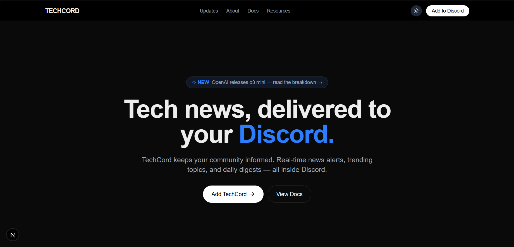

# TechCord — Tech News Platform for Discord

> **Note on repository access:** TechCord was a team project. This is my public showcase repository; the original team repositories contain provided starter code and remain private for academic integrity reasons. This README documents my contributions and design decisions. Representative code excerpts are in [`showcase/`](./showcase).

  

## 🎥 Demo Recording

## What it is

TechCord delivers technology news to Discord communities through a bot (real-time alerts, slash commands, daily digests) and a companion website showing live news and trending topics.

- **Live website:** [techcord-website.vercel.app](https://techcord-website.vercel.app) (Next.js/TypeScript, deployed on Vercel)
- **Team backend repo (private):** Node.js/Express bot built with discord.js — my commits are in its history alongside my teammate's

## What I did (and why)

### Slash commands: `/news`, `/trending`, `/digest`
I implemented the bot's user-facing command layer, from command registration (`deploy-commands.js`) through to responses rendered as structured **Discord embeds** — colour-coded, grouped by source, and capped for readability. Discord embeds are a design problem as much as a coding one: the constraint of a chat message forces real decisions about hierarchy and information density.

### News aggregation & categorisation
I integrated multiple external APIs (TechCrunch, The Verge, Hacker News), normalising their different response formats into one internal article shape, then implemented topic filtering and categorisation so users get relevant news rather than a firehose. This is where the project taught me the most about **API integration**: real-world endpoints disagree about everything (field names, timestamps, pagination) and your job is to absorb that mess at the boundary.

### Scheduled background jobs
The daily digest is produced by a scheduler that fetches, ranks and formats the day's top stories without any user interaction — my introduction to background jobs and state that lives outside the request/response cycle.

### Frontend contributions
On the Next.js/TypeScript website I contributed the news display and trending components, consuming the same data layer the bot uses.

## How I built it

| Component | Technology | Notes |
| --- | --- | --- |
| Discord bot | Node.js, Express, discord.js | Slash commands, embeds, scheduled jobs (`src/commands`, `src/scheduler`, `src/services`) |
| Data | SQLite, SQL | Article cache, category mapping (`src/database`) |
| Integrations | TechCrunch, The Verge, Hacker News APIs | Response normalisation, filtering, categorisation |
| Website | Next.js, TypeScript, Vercel | [techcord-website.vercel.app](https://techcord-website.vercel.app) |

### Teamwork
Five team, Git/GitHub for version control. We split along frontend/backend lines with shared ownership of the data layer and API contracts — deliberate interface agreements up front kept our merges clean.

## Challenges & what I learned

- **Designing for a chat medium.** A Discord embed is nothing like a webpage. Ranking and *omitting* stories became the core skill — a digest that dumps 40 links is worthless.
- **Third-party APIs fail.** Rate limits, empty results and slow responses from news sources forced defensive handling around every fetch: timeouts, fallbacks, and never letting one broken source kill the digest.
- **Contracts between teammates.** Agreeing the article data shape before either of us wrote UI code saved significant rework — my first real experience of interface-first teamwork.

## What I'd do differently

- Add **tests around the API normalisation layer** — it's the most regression-prone part of the codebase.
- Persist article history longer to power real trend detection rather than a single-day window.
- Move the scheduler to a queue (e.g. BullMQ) with retry logic instead of naive intervals.

## Acknowledgements

Team coursework at Manchester Metropolitan University. The private original repositories began from starter code provided by the module team; the features described above are my contributions, developed with my teammate.
